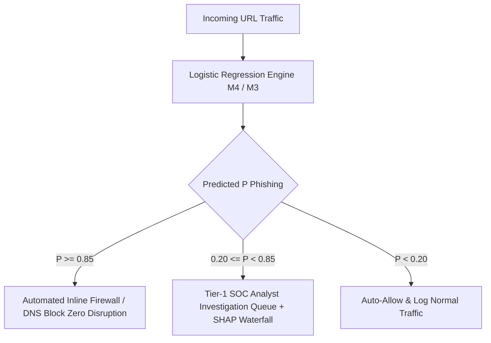

# 🛡️ Phishing URL Detection — SecMLOps, Parameterized Logistic Regression & Explainable AI (SHAP)

[](https://www.python.org/)
[](https://scikit-learn.org/)
[](https://shap.readthedocs.io/)
[]()

> **Master in Intelligent Systems and Cyber Defense (MSSIC)**  
> **Module M115: AI & Intelligent Systems**  
> **Institution:** ENSIASD Taroudant — Ibn Zohr University  
> **Instructor:** Prof. Sara EL-ATEIF | **Academic Year:** 2026–2027

---

## 📌 Project Overview

This laboratory project implements a complete, leakage-free **SecMLOps pipeline** for high-throughput phishing URL detection on the benchmark **PhiUSIIL Phishing URL Dataset** (235,795 URLs, 56 lexical, network, and HTML features; Prasad & Chandra, *Computers & Security*, 2024).

The work bridges theoretical Machine Learning with operational **Security Operations Center (SOC)** constraints:
1. **Security-Oriented EDA & Label Alignment:** Aligning the target class (`1 = Phishing, 0 = Benign`) to ensure threat detection validity, and analyzing why naive static rules (e.g., *"If HTTPS then Safe"*) fail catastrophically.
2. **Zero-Data Leakage SecMLOps:** Stratified 75/25 partitioning prior to Z-score standardization, strictly preventing test distribution leakage into the training phase.
3. **Regularization & Edge Sparsity (L1 vs. L2):** Evaluating unregularized, L2 Ridge, and sparse L1 Lasso models. Demonstrating that **L1 Lasso ($C=0.01$)** eliminates **~50% of features (24/49)** with zero practical performance loss ($F_1 = 0.9982$), halving inspection latency for real-time firewall engines.
4. **Model Explainability (XAI with SHAP):** Computing exact game-theoretic Shapley values (`shap.LinearExplainer`) for global risk attribution and local triage waterfall plots across True Positive, True Negative, and False Positive (false alarm) incidents.
5. **Operational Dual-Threshold SOC Policy:** Calibrating decision thresholds across $\tau \in \{0.20, 0.50, 0.85\}$ to balance Threat Hunting recall against Automated Inline Blocking precision.

---

## 📊 Experimental Results Summary

| Model Configuration | Penalty | $C$ | Precision | Recall (TPR) | $F_1$-Score | PR-AUC | False Alarms (FP) | Missed Phish (FN) | Active Features |
| :--- | :---: | :---: | :---: | :---: | :---: | :---: | :---: | :---: | :---: |
| **M1: Unregularized** | None | $\infty$ | 0.9996 | 0.9990 | 0.9993 | 1.000 | 11 | 25 | 49 / 49 |
| **M2: Strong L2 Ridge** | L2 | 0.001 | 0.9985 | 0.9958 | 0.9971 | 1.000 | 39 | 105 | 49 / 49 |
| **M3: Standard L2 Ridge** | L2 | 1.0 | 0.9996 | 0.9989 | 0.9992 | 1.000 | 10 | 28 | 49 / 49 |
| **M4: Sparse L1 Lasso** ⭐ | **L1** | **0.01** | **0.9993** | **0.9971** | **0.9982** | **1.000** | **18** | **72** | **25 / 49 (24 Zeroed)** |
| **M5: SOC Balanced L2** | L2 | 1.0 | 0.9995 | 0.9990 | 0.9992 | 1.000 | 13 | 25 | 49 / 49 |

---

## 🛡️ Recommended SOC Deployment Architecture (Dual-Threshold)



* **Automated Firewall Mode ($\tau = 0.85$):** Eliminates false alarms on critical enterprise workflows while immediately neutralizing confirmed attacks.
* **Tier-1 Human Queue ($0.20 \le P < 0.85$):** Analysts inspect ambiguous border cases using instance-level **SHAP Waterfall Plots** (unscaled metrics) to rapidly uncover evasive obfuscation without disrupting business continuity.
* **Threat Hunting Mode ($\tau = 0.20$):** Used during active threat campaigns to maximize recall and intercept stealthy APT phishing.

---

## 📂 Repository Structure

```text
├── M115_Lab1_1.ipynb             # Completed Jupyter Notebook with all outputs & reflection answers
├── Resume_Lab1_English.md        # Comprehensive English study guide & exercise breakdown
├── Resume_Lab1_Darija.md         # Intuitive review sheet in Moroccan Darija (Arabizi)
├── PhiUSIIL_Phishing_URL_Dataset.csv # Dataset (235,795 URLs)
└── README.md                     # Project documentation and SOC synthesis
```

---

## 🚀 How to Run

1. Clone this repository:
   ```bash
   git clone https://github.com/<your-username>/M115-Cyber-AI-Labs.git
   cd M115-Cyber-AI-Labs
   ```
2. Install dependencies:
   ```bash
   pip install numpy pandas scikit-learn matplotlib seaborn shap
   ```
3. Open and run the notebook in Jupyter or Google Colab:
   ```bash
   jupyter notebook M115_Lab1_1.ipynb
   ```

---

## 🔗 External Links & Contributions
* **Kaggle Code Notebook:** [Kaggle Notebook Contribution](https://www.kaggle.com/code/drewcanflyy/m115-lab1-phishing-detection-secmlops)
* **Dataset Source:** [UCI Machine Learning Repository / Kaggle PhiUSIIL](https://archive.ics.uci.edu/dataset/967/phiusiil+phishing+url+dataset)

